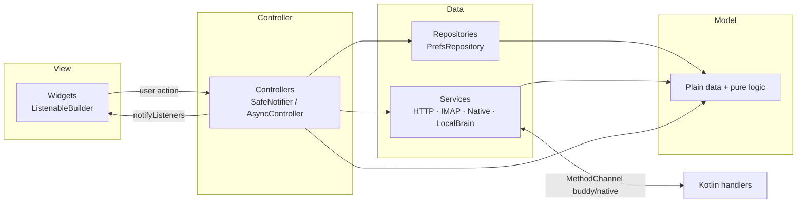
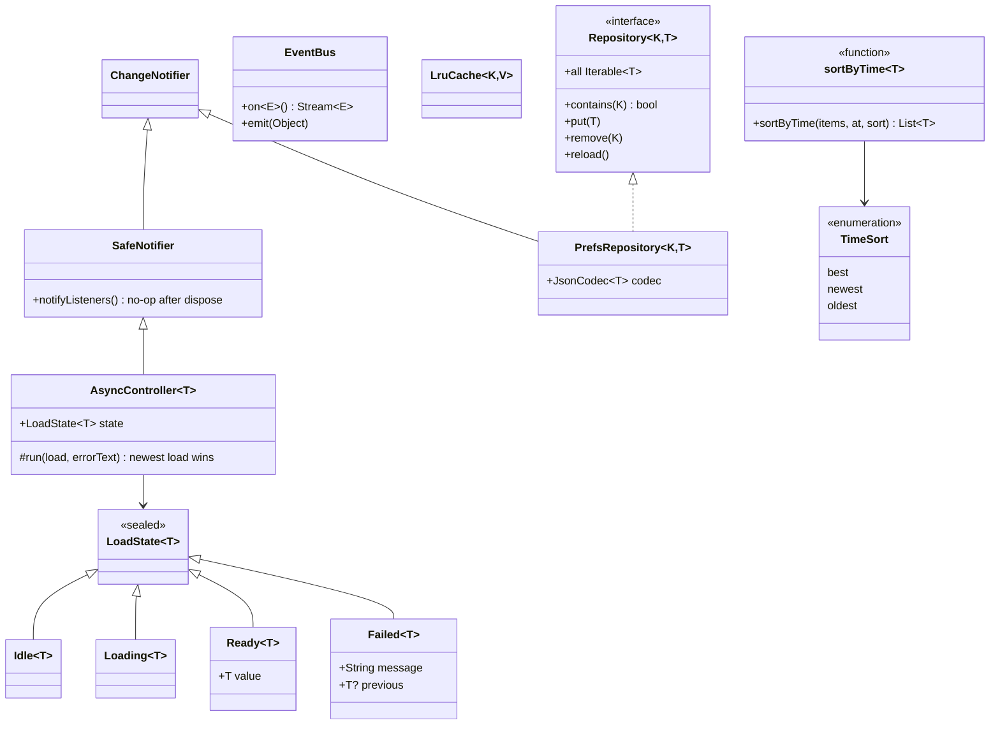
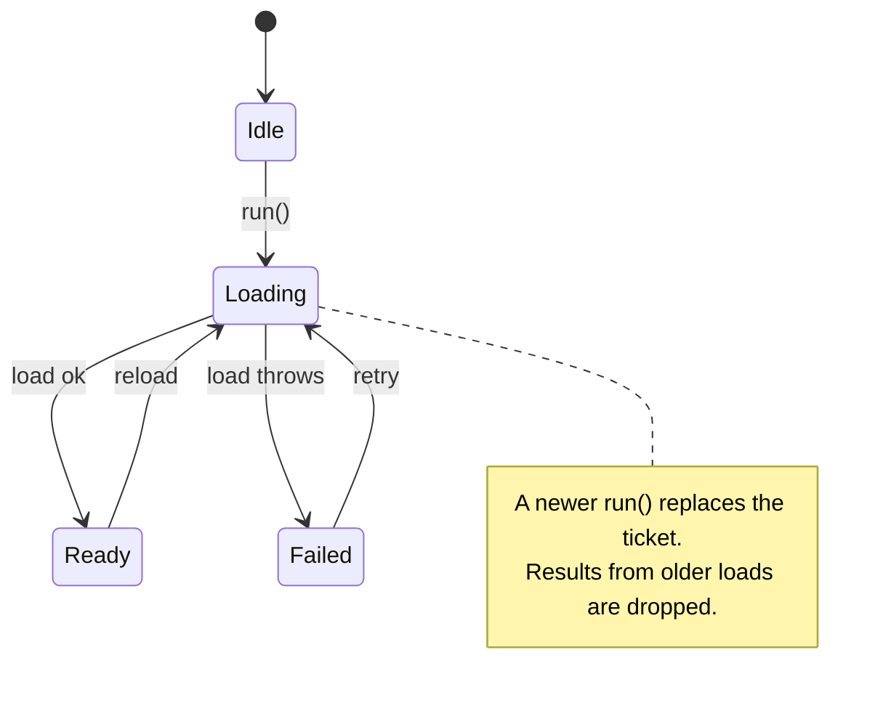
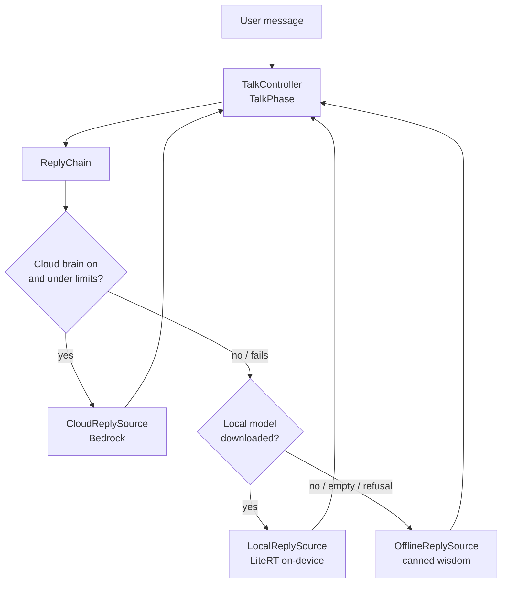
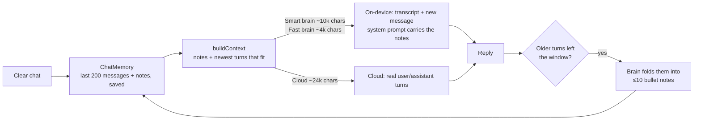
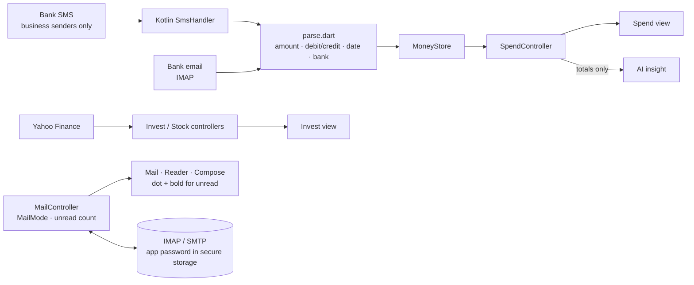
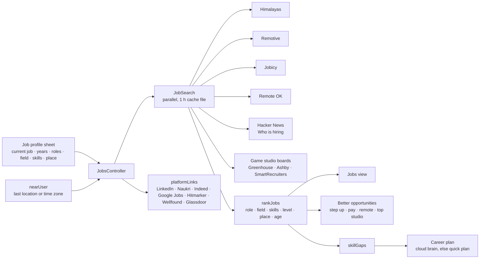
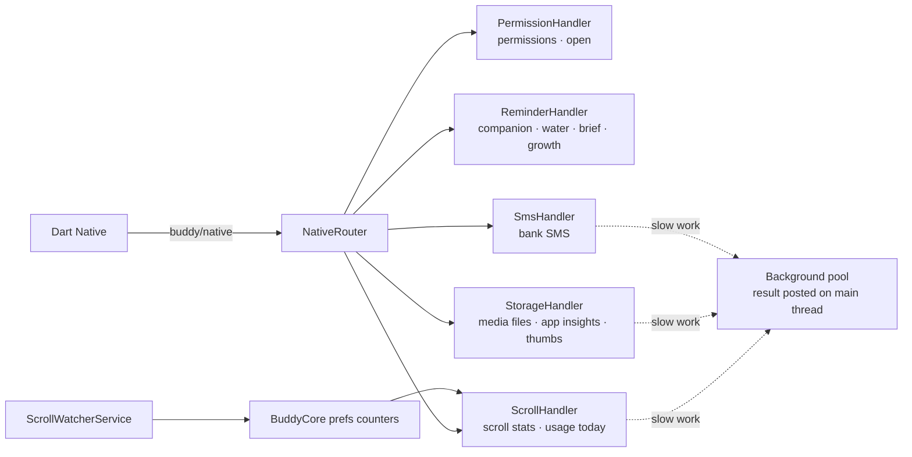
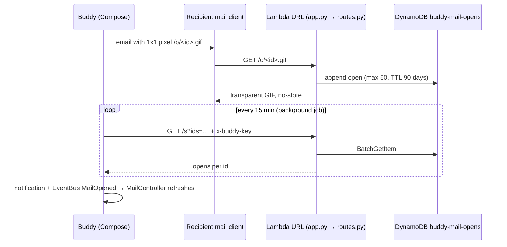

# Buddy

A personal wellbeing companion for Android, built with Flutter. It has five tabs:

- **Buddy:** quests, water, mood and talk (an AI chat that remembers the session).
- **Grow:** learn, practice, news (sortable by time), courses and stars.
- **Health:** workouts, body and food.
- **Money:** spend, invest, mail (with unread markers) and jobs.
- **Phone:** scroll tracking, the storage cleaner and offline maps (download an area, then get the fastest or shortest route with spoken turn-by-turn directions, even without internet).

Most work happens on the phone. Talk uses an on-device LLM, and the cloud brain (AWS Bedrock) is optional and capped by spend limits. Jobs searches free public job boards and game studio careers pages, with no accounts or API keys. A small optional AWS backend logs read receipts for mail you send. Map tiles come from [buddy-maps](https://github.com/raghavpatpatia/buddy-maps), a weekly GitHub Action that turns OpenStreetMap data into road tiles; routing on the phone uses a Customizable Contraction Hierarchy (`lib/features/nav/model/cch.dart`).

## Look and feel

Buddy uses calm, high-contrast themes meant to suit every age. All art is original and drawn in code.

- **Themes:** twenty, in ten day + night pairs (`botColors` and `themePairs` in `lib/core/game.dart`), one pair unlocked per level: Morning · Midnight, Mint · Forest, Sand · Plum, Lavender · Dusk, Peach · Ember, Ocean · Deep Sea, Rose · Wine, Sunshine · Amber Night, Stone · Graphite, Pearl · Royal. Pick a pair under Trophies → Theme; the Day / Night switch (also in Settings → Appearance) follows the phone's dark mode until you choose, then keeps your choice. A theme recolours the whole app at once (`applyBotTheme`), keeping your place.
- **Palette:** `SystemColors` in `lib/shared/ui.dart` holds the current theme's background, cards, accent, text accent and warm second colour; everything reads from it.
- **Background and cards:** `SystemBackground` paints the theme's background with a faint wash of its accent; cards are plain and rounded with soft shadows (no glow). Text uses the phone's Roboto font.
- **Buddy:** a shadow-knight helm (`lib/shared/bot_face.dart`) with swept horns, a V visor, glowing slit eyes, a forehead gem and rising shadow flames. Eyes glow in the theme's colours and show mood and the vent grille pulses while he talks. Unlockable eye colours still apply.
- **Ranks:** E-Rank → S-Rank Hunter over levels 1–10, then National Level Hunter and Monarch. Level-ups appear as a `[SYSTEM]` message.
- **Voice:** "Shadow voice" (`shadowize` in `lib/features/talk/data/robot_voice.dart`) turns the phone's TTS into a deep armoured voice. It pitches down about 3 semitones without slowing (two crossfaded delay-line heads), adds bass weight, rolls off the highs, adds soft drive, a helmet comb resonance and a short dark echo. It can be switched off in Buddy's brain settings.
- **Icons:** the launcher icon and splash come in day (Morning) and night (Midnight) versions, picked by the phone's dark mode (adaptive: soft background, helm foreground, monochrome themed layer), the Android 12+ splash and the status-bar icon all use the same helm. To regenerate both after changing the art, run `flutter test tool/render_icons_test.dart && tool/install_icons.sh`. The notification vector is `res/drawable/ic_stat_buddy.xml`, and notifications are tinted Morning blue.

## Project layout

```
lib/
  main.dart              entry point only
  app/                   BuddyApp, HomeShell, tab sections
  core/                  app-wide services: Store, Native channel, background jobs, formatting
    arch/                generic building blocks: EventBus, LoadState, AsyncController,
                         Repository, PrefsRepository, LruCache, SafeNotifier, TimeSort
  shared/                reusable widgets (ui + System theme, SortButton, background, bot face, celebrate)
  features/<feature>/    astro, grow, health, home, jobs, money, phone, settings, talk
    model/               plain data + pure logic (no Flutter, no I/O)
    data/                I/O: prefs, HTTP, IMAP/SMTP, native, model files
    controller/          ChangeNotifier state holders (one job each)
    view/                widgets; read controllers via ListenableBuilder
android/app/src/main/kotlin/com/raghav/buddy_app/
  MainActivity.kt        wires the buddy/native channel
  channel/               one handler per domain (command pattern)
  BuddyCore.kt           reminders, notifications, scroll counters
  ScrollWatcherService   accessibility service that counts reels/shorts
server/tracker/          read-receipt backend (Lambda + DynamoDB, CloudFormation)
test/                    unit + widget tests
```

## Architecture

### Layers (MVC)

Dependencies point one way only: view → controller → data → model. Views never call data services directly, and models know nothing about Flutter.



### Generic building blocks (`lib/core/arch`)



| Pattern | Where |
|---|---|
| Observer | `SafeNotifier`/`ChangeNotifier` controllers and `PrefsRepository`, watched by `ListenableBuilder`; `EventBus` for cross-feature events (`MailOpened`) |
| State | `LoadState` (Idle → Loading → Ready/Failed), `TalkPhase`, `PracticePhase`, `SessionPhase`, `ScanStatus`, `MailMode` |
| Chain of Responsibility | Talk `ReplyChain`: Cloud → Local → Offline |
| Strategy | Money `TxnSource`: `SmsTxnSource`, `EmailTxnSource`; Jobs `JobSource`: Himalayas, Remotive, Jobicy, Remote OK, Hacker News, game studio boards; `TimeSort` order for News and Jobs |
| Repository | `Repository<K,T>` with `PrefsRepository` + `JsonCodec<T>` |
| Command | Kotlin `ChannelHandler` routes: method name → action |
| Singleton | `Store`, `Native`, `LocalBrain`, `CloudBrain`, `ModelDownloads`, `JobStore` |

### Async loading: newest load wins



### Talk: who answers



### Talk: session memory

Every reply sees the whole session, not just the last message. The chat and its memory notes are saved on the phone, survive restarts, and are wiped by **Clear chat**.



- Recent turns go to the brain word for word. Turns that no longer fit are summarised into short notes (names, plans, numbers, decisions), so nothing important is forgotten.
- The persona is a general assistant (facts, planning, money, code, life) that adapts answer length. Indian-wisdom cards only appear for feelings and life questions.
- Replies render light markdown: **bold**, `code`, headings, bullet lists and code blocks.

### Money: data flow and privacy



Rules enforced in code:

- SMS from phone numbers (people) are never read.
- Only the amount, direction, date and bank are kept.
- The AI sees totals only.
- Sending or deleting mail always asks first.

### Jobs: search, rank, suggest



- The default profile is SDE-1 in game development, near you. More roles and fields can be picked, and "Anywhere" searches worldwide.
- Each job gets a 0–100 match score. Scores under 30 and off-field crafts (art, design, producer) are left out unless you picked that role.
- One source being down only shows "Couldn't reach …". Results are cached for an hour in their own file and used offline.
- Only the profile and job titles go to the cloud brain, and only when you ask for a career plan.

### Sorting by date and time

News and Jobs use one generic helper: `sortByTime(items, at, TimeSort)` in `core/arch/time_sort.dart`, plus the shared `SortButton` widget. Each controller remembers its choice.

| List | Default | Other orders |
|---|---|---|
| News | Top (feed order) | Newest, Oldest |
| Jobs matches | Best match | Newest, Oldest |
| Saved jobs | Newest | Oldest |

Items without a date always go last.

### Mail: read and unread

Unread emails show a dot in front of the sender's avatar, a bold sender and subject, and a colored date. The list header says how many are unread ("3 unread" or "All read"). Opening an email marks it read in the list right away. The read flag comes from the server (IMAP `\Seen`), so it matches Gmail.

### Native bridge (Kotlin)



## Backend: read-receipt tracker

Optional. It runs in your own AWS account and fits the free tier. It stores only the open time and the user agent, and records expire after 90 days.



```
server/tracker/
  src/app.py        Lambda entry: wires DynamoOpensStore into the router
  src/routes.py     HTTP layer: /o/<id>.gif and /s
  src/store.py      DynamoOpensStore (DynamoDB access)
  tests/            unittest with an in-memory store, no AWS needed
  template.yaml     CloudFormation: table, role, function, public URL
  deploy.sh         runs tests, deploys stack, uploads code, writes setup file
```

To deploy, run `aws login`, then:

```sh
server/tracker/deploy.sh
adb push /tmp/buddy_tracker.txt /sdcard/Download/
```

Buddy imports the setup file and then deletes it.

## Build and test

```sh
flutter analyze
flutter test                                    # Dart unit + widget tests
python3 -m unittest discover -s server/tracker/tests
flutter build apk --release --build-number <N>  # N must be above the installed build
```

Notes for testing on a device:

- On-device models go in `Download/BuddyModels/`. Talk works without them and uses the offline replies.
- Do not `am force-stop` the app during testing. Android then turns off the scroll-tracker accessibility service.
